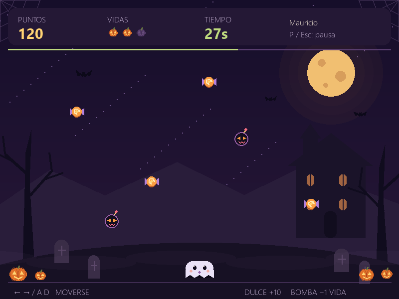

# Coin Hunter 2D — Noche de Halloween

Proyecto de la actividad **Semana 2 — Vibecoding**. Es un minijuego desarrollado en Python con Pygame, utilizando IA como asistente para generar, revisar y mejorar el código.

## 1. Aplicación funcional

### Objetivo del juego

Controlar un fantasma, recoger dulces y esquivar bombas embrujadas durante una partida de 45 segundos. Cada dulce suma 10 puntos. El jugador comienza con tres vidas y dispone de un segundo de protección después de recibir un golpe.

El proyecto funciona localmente. No requiere bases de datos ni servicios externos. Los gráficos se dibujan con Pygame y no necesitan imágenes descargadas.

### Instalación y ejecución

Requisitos: Python 3.10 o posterior y Pygame 2.6.1. La instalación del proyecto se ha comprobado con Python 3.13.1.

Abre una terminal de PowerShell **dentro de la carpeta `juego`**. Si todavía no existe el entorno virtual, créalo:

```powershell
python -m venv venv_game
```

Instala las dependencias y ejecuta el programa usando ese entorno:

```powershell
.\venv_game\Scripts\python.exe -m pip install -r requirements.txt
.\venv_game\Scripts\python.exe main.py
```

Si las dependencias ya están instaladas, basta con el último comando. No es necesario activar el entorno virtual.

### Controles

- Escribe tu nombre y pulsa **Enter** o el botón de inicio.
- **Flechas izquierda/derecha** o **A/D**: mover al personaje.
- **P** o **Esc** durante la partida: pausar y continuar.
- La partida también se pausa cuando la ventana pierde el foco.
- **Enter** o **R** en los resultados: volver a jugar.
- **N** en los resultados: cambiar de jugador.
- **Esc** en el inicio o en los resultados: salir.

### Organización del proyecto

```text
juego/
├── main.py
├── modelo.py
├── tema_halloween.py
├── requirements.txt
├── .gitignore
├── README.md
├── tests/
│   └── test_modelo.py
└── capturas/
    ├── halloween-inicio.png
    ├── halloween-partida.png
    ├── halloween-pausa.png
    └── halloween-resultado.png
```

- `main.py`: pantallas, entrada de nombre, eventos, controles y bucle principal.
- `modelo.py`: reglas, movimiento, colisiones, puntos, vidas y tiempo, independientes de Pygame.
- `tema_halloween.py`: colores, escenario, personajes y objetos dibujados con Pygame.
- `tests/test_modelo.py`: pruebas automáticas de las reglas, sin abrir una ventana ni importar Pygame.
- `requirements.txt`: dependencia de Pygame con su versión fijada.
- `.gitignore`: excluye el entorno virtual y los archivos temporales del control de versiones.
- `capturas/`: vistas previas de las pantallas para revisar el diseño.

## 2. Evidencia de vibecoding y evolución de los prompts

Los cuatro prompts siguientes son versiones ampliadas, redactadas en esta conversación para documentar y reproducir las etapas. No son transcripciones literales de las instrucciones iniciales. Al final de esta sección se incluyen fragmentos de tres solicitudes originales del historial como evidencia de uso de la IA.

### Prompt 1: estructuración del proyecto

```text
Actúa como mi asistente de programación para una actividad de vibecoding.

Quiero desarrollar Coin Hunter 2D, un minijuego sencillo en Python con
Pygame para una demostración de clase. Estoy aprendiendo, así que utiliza
código claro, nombres descriptivos en español y comentarios que expliquen
las decisiones importantes.

Todo el proyecto debe estar únicamente dentro de una carpeta llamada
juego. No incluyas Angular, TypeScript, frontend, backend, APIs ni bases
de datos.

Organiza los archivos así:

juego/
├── main.py
├── modelo.py
├── requirements.txt
├── .gitignore
├── README.md
└── tests/
    └── test_modelo.py

Responsabilidades:
- main.py: ventana, eventos, controles y dibujo con Pygame.
- modelo.py: reglas y estado de la partida, independientes de Pygame.
- requirements.txt: dependencias necesarias.
- .gitignore: excluir el entorno virtual y los archivos temporales.
- README.md: instalación, ejecución, controles y explicación del proyecto.
- tests/test_modelo.py: pruebas de las reglas cuando se implementen.

Comencemos con una versión mínima: una ventana de 800 × 600, un personaje
rectangular que se mueva horizontalmente con las flechas y que no pueda
salir de la pantalla.

Completa correctamente el bucle de eventos, la actualización de pantalla,
el control de fotogramas y el cierre del programa.
```

**Qué se pidió:** una estructura clara y una primera versión que permitiera abrir la ventana y mover al personaje.

**Por qué se planteó así:** empezar con una funcionalidad pequeña facilitó comprobar la instalación y comprender el bucle principal antes de añadir más reglas.

### Prompt 2: juego completo

```text
Sobre la versión anterior de Coin Hunter 2D, implementa estas mejoras
manteniendo toda la aplicación dentro de juego:

1. Pantalla inicial para escribir el nombre del jugador.
2. Movimiento con las flechas izquierda/derecha y con A/D.
3. Monedas que caen y suman 10 puntos al recogerlas.
4. Bombas que caen y restan una vida al tocar al jugador.
5. Tres vidas y partidas de 45 segundos.
6. Un segundo de protección después de recibir un golpe.
7. Pausa y reanudación con P o Escape.
8. Pausa automática cuando la ventana pierde el foco.
9. Pantalla final con puntuación y opciones para repetir o cambiar jugador.

Separa las reglas en modelo.py y la presentación en main.py.
Calcula el movimiento usando el tiempo transcurrido para que no dependa
de la velocidad del equipo.

Dibuja los elementos con Pygame, sin necesitar imágenes externas.
No guardes partidas ni añadas servicios externos.
```

**Qué se pidió:** convertir el movimiento básico en un juego con objetivos, obstáculos, puntuación y un ciclo completo de partida.

**Por qué se refinó:** la primera versión permitía comprobar la base técnica, pero todavía necesitaba un límite de tiempo, vidas, controles de pausa y una forma de volver a jugar.

### Prompt 3: validaciones

```text
Revisa Coin Hunter 2D y ayúdame a validar su funcionamiento.

Añade pruebas con unittest para las reglas de modelo.py:
- Validación del nombre.
- Límites del movimiento.
- Puntuación al recoger monedas.
- Pérdida de vidas y protección temporal.
- Pausa.
- Fin por tiempo o por pérdida de vidas.
- Reinicio de una partida.

Las pruebas deben ejecutarse sin abrir una ventana y sin necesitar Pygame.

Comprueba que las monedas no puntúen varias veces y que una partida
terminada no siga modificando sus resultados.

También explica cómo resolver el error «Cannot find module pygame»
cuando está instalado en venv_game, pero el editor utiliza el Python
global. Proporciona comandos para comprobar el intérprete y la instalación.
```

**Qué se pidió:** validar las reglas y revisar los problemas de reconocimiento de las dependencias en el editor.

**Por qué se refinó:** generar el código no garantizaba que funcionara correctamente en el entorno local. Era necesario comprobar comportamientos concretos y distinguir los errores del juego de los avisos del editor.

### Prompt 4: mejora de la interfaz con temática de Halloween

```text
Quiero mejorar la interfaz de Coin Hunter 2D con una temática de Halloween.
Trabaja únicamente dentro de la carpeta juego e implementa estos cambios:

1. Utiliza una paleta de colores morados, naranjas y tonos oscuros.
2. Diseña un escenario nocturno con luna, casa embrujada, árboles secos,
   calabazas, telarañas y murciélagos.
3. Cambia la apariencia del jugador por un fantasma.
4. Representa las monedas como dulces y dale a las bombas una apariencia
   embrujada. Los dulces deben seguir sumando 10 puntos.
5. Adapta las pantallas de inicio, pausa y resultados al nuevo diseño.
6. Mantén los textos legibles y los botones fáciles de identificar.

Conserva las reglas actuales: tres vidas, partidas de 45 segundos,
protección temporal después de un golpe y los mismos controles.

Separa el diseño visual en tema_halloween.py, mantén las reglas en
modelo.py y conecta la presentación desde main.py.

Dibuja los elementos con las funciones de Pygame, sin descargar imágenes
ni añadir dependencias.
```

**Qué se pidió:** renovar la apariencia del juego y darle una identidad de Halloween.

**Por qué se refinó:** una vez comprobadas las reglas, se buscó mejorar la presentación sin introducir nuevas dependencias ni cambiar el comportamiento que ya funcionaba.

### Fragmentos de solicitudes originales del historial

Estos extractos corresponden a mensajes enviados durante el trabajo con la IA; permiten distinguir las solicitudes reales de sus versiones ampliadas anteriores.

1. **Desarrollo inicial:** «Nuestro primer objetivo concreto será completar las fases 1 y 2: tener Coin Hunter 2D completamente jugable, sin base de datos todavía».
2. **Diagnóstico de dependencias:** se comunicó «Me da error» junto con el mensaje `Cannot find module pygame` y las rutas donde el editor estaba buscando la librería.
3. **Iteración visual:** «quiero que pongas el diseño del juego con la tematica de halloween».

La primera solicitud definió el alcance del juego; la segunda añadió información del entorno para resolver un problema; la tercera pidió una modificación visual concreta. El historial completo de la conversación permite consultar su contexto.

## 3. Iteración y mejora

La versión inicial utilizaba un personaje rectangular y una presentación sencilla. La mejora de Halloween añadió:

- Un escenario nocturno con luna, casa embrujada, árboles secos, telarañas, murciélagos, niebla y calabazas.
- Un fantasma como personaje y dulces como objetos que suman puntos.
- Bombas con caras de Halloween y calabazas para representar las vidas.
- Una paleta morada y naranja compartida por inicio, juego, pausa y resultados.

La presentación se separó en `tema_halloween.py`. Internamente, `modelo.py` sigue usando el tipo `moneda`; la interfaz lo representa como un dulce. Se conservaron las velocidades, las colisiones, la puntuación y los controles.

Vista previa del diseño final:



Esta captura se generó con un estado controlado para comprobar el diseño; no representa una partida jugada manualmente.

## 4. Validación del resultado

### a. Cómo se probó el código

Se ejecutaron **11 pruebas automáticas con `unittest`**, todas con resultado satisfactorio. Comprueban:

- Validación y limpieza del nombre.
- Movimiento independiente de los fotogramas y límites de la pantalla.
- Recogida de monedas y puntuación una sola vez por objeto.
- Pérdida de vidas y protección temporal frente a golpes consecutivos.
- Pausa del tiempo, movimiento y colisiones.
- Finalización por tiempo o pérdida de todas las vidas.
- Eliminación de objetos fuera de la pantalla y reinicio del estado.

Para repetirlas desde la carpeta `juego`:

```powershell
.\venv_game\Scripts\python.exe -m unittest discover -s tests -v
```

También se ejecutó Pygame sin ventana visible para comprobar el ingreso del nombre, el inicio, el dibujo de las pantallas, la pausa, el final, el reinicio y el cierre. Se revisaron visualmente las cuatro pantallas renderizadas de `capturas/` para detectar textos superpuestos o cortados.

Estas comprobaciones no sustituyen una partida manual completa. Para repetir la validación interactiva, inicia el juego, recoge un dulce, toca una bomba, pausa, cambia de ventana y vuelve a jugar. Comprueba que se sumen 10 puntos por dulce y que se apague una calabaza por cada vida perdida.

### b. Errores, limitaciones y ajustes realizados

- **Dependencia no reconocida:** el editor no encontraba `pygame`, aunque estaba instalado en `venv_game`. Se comprobó que estaba buscando en el Python global y se configuró el intérprete del entorno virtual.
- **Módulo local no reconocido:** apareció el aviso `Import "tema_halloween" could not be resolved`. Se verificó que el archivo existía y que Python podía importarlo. Se ajustaron las rutas de búsqueda del editor; el análisis debe recargarse para recoger la configuración.
- **Legibilidad:** un texto de la pantalla inicial quedaba sobre la luna. Se acortó para evitar la superposición y se volvió a revisar su renderizado.
- **Limitaciones actuales:** el juego utiliza una ventana fija de 800 × 600 y no guarda las puntuaciones al cerrar. El tiempo de simulación limita los saltos grandes de fotogramas, por lo que en un equipo muy lento una partida puede durar más de 45 segundos de reloj.

## 5. Reflexión final

### a. Qué aprendí usando IA para programar

Aprendí a dividir un proyecto en pasos pequeños y a escribir instrucciones específicas. También comprendí la importancia de separar las reglas del juego de su presentación visual y de comprobar el código generado antes de considerarlo terminado.

### b. Ventajas y límites del vibecoding

La IA permitió avanzar rápidamente, organizar los archivos y proponer mejoras visuales. Sin embargo, puede generar código que necesite ajustes o asumir una configuración diferente de la instalada. Por eso es necesario revisar sus respuestas, probar el programa y proporcionar los mensajes de error completos.

### c. Código que comprendo y aspectos por reforzar

Comprendo cómo se capturan las teclas, se suman puntos, se descuentan vidas y se reinicia una partida. Necesito reforzar el cálculo del movimiento mediante el tiempo transcurrido, la detección de colisiones y algunas funciones de dibujo de Pygame.

## Preparación de la entrega

Entrega esta carpeta con el código, `requirements.txt`, las pruebas, las capturas y este README, mediante un archivo comprimido o un repositorio.

El entorno `venv_game`, las carpetas `__pycache__` y la configuración local del editor no necesitan incluirse. La carpeta `web/` pertenece a una versión anterior de Angular y debe excluirse de esta entrega de Python; tampoco se necesitan las carpetas externas `frontend` ni `backend`.

La reflexión personal debe coincidir con lo que el estudiante puede explicar. Los fragmentos del historial pueden acompañarse con capturas o enlaces a la conversación para facilitar la revisión de los prompts originales.
